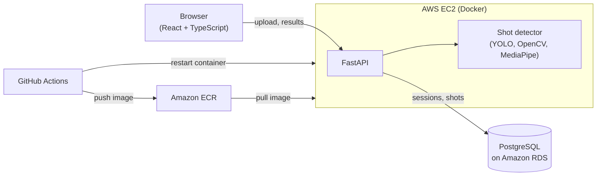

# CourtIQ

Upload a video of yourself shooting and CourtIQ finds every shot, calls it a make or a miss,
and measures your form on each one. You get the video back with the ball and rim drawn on it,
a list of shots you can click to jump to, and your numbers over time.

Try it at http://16.58.191.114/. I turn the server off when I'm not using it to save AWS
credits, so if the page doesn't load, it's off for now.

I'm also trying out a second design called Studio at http://16.58.191.114/studio/. It has the
same data with a sidebar and tabs. Both use the same login, and I'll keep whichever one I like
more.

I built it because I love basketball and practice a lot at home. I wanted to study fatigue:
does my form change when I get tired, and how much does that hurt my shooting? Knowing that
should help me become a better shooter. Also, it's fun.

## How it works



1. The API saves the upload and runs the detector in the background.
2. A YOLO model finds the ball and the hoop. It looks at every 4th frame, and at every frame
   once a shot is on its way to the rim. A shot is the ball coming down
   from above the rim to rim height within a second. If the ball then shows up under the rim
   twice, it's a make. If it bounces back up above the rim, it's a miss.
   ([vision/rim_shot_detector.py](vision/rim_shot_detector.py))
3. For the 2.5 seconds before each shot, MediaPipe finds the shooter's joints, and CourtIQ
   measures five form numbers: knee bend, elbow bend, arm angle at release, jump height and
   the ball's flight time. ([vision/shot_form.py](vision/shot_form.py))
4. Shots and form numbers go into PostgreSQL. The page asks the API for them and plays the
   annotated video.

## Results

### Shot detection

Measured on 6 clips I filmed by hand, 63 shots in total (32 makes, 31 misses):

| Found | Make or miss called right | False shots | Fully correct |
|---|---|---|---|
| 62 of 63 | 60 of 62 | 0 | 60 of 63 (95%) |

Two mistakes are misses that were called makes. The third is an airball that leaves the picture
at rim height and is not found. Before the detector was made about twice as fast it found that
one too (61 of 63, [docs/speed-plan.md](docs/speed-plan.md)). The rules were tuned on these
same 6 clips, so new clips will probably score a bit lower. Every version of the detector and
its score is in [docs/detector-results.md](docs/detector-results.md).

### Database speed

With 1 million shots in the database:

| Query | Fix | Before | After |
|---|---|---|---|
| One month's sessions with makes and shooting % | Composite index on `shots (session_id, result)` | 62.8 ms | 17.3 ms |
| Shooting % for every month | Materialized view `monthly_stats` | 234.8 ms | 0.54 ms |

The `EXPLAIN ANALYZE` plans, the index that didn't help, and how to rerun it are in
[docs/query-optimization.md](docs/query-optimization.md).

## Run it yourself

You need Docker.

```bash
docker compose up -d --build
```

Then open http://localhost:8000. A 47 second clip took about 42 seconds to process in Docker
on my laptop with the container limited to 2 CPUs.

To run the tests (they use the Postgres container from above):

```bash
pip install -r requirements.txt
python -m pytest -q tests
```

To work on the page with hot reload, keep the containers running and start Vite. It sends
`/api` calls to port 8000.

```bash
npm --prefix frontend install
npm --prefix frontend run dev
```

## Deploying

Every push and pull request runs the tests and builds the frontend
([.github/workflows/ci.yml](.github/workflows/ci.yml)). When something lands on `main`,
GitHub Actions also builds the Docker image, pushes it to Amazon ECR and restarts the
container on EC2. GitHub has no AWS keys. It signs in through OIDC and gets credentials that
expire after an hour. From merge to live takes about four minutes.

Setting up AWS from scratch, every command I ran, and what it costs are in
[docs/deploy.md](docs/deploy.md).

## What's in the repo

- `vision/` the detector and the form measurements
- `backend/` the FastAPI app and the SQL
- `db/` the schema and the script that makes the 1M row test data
- `frontend/` the React page
- `eval/` scoring scripts and the shot labels
- `tests/` pytest tests
- `docs/` results and the deploy guide

## Known limits

- Logging in takes only an email, with no password, so anyone who knows your email can see your sessions.
- The site is plain HTTP, so the login cookie isn't protected on public Wi-Fi (`docs/deploy.md`, section 9).
- The clips are all filmed from behind the shooter. Other angles haven't been tested.
- The server has 2 CPUs, so the same 47 second clip takes about 3.5 minutes there.
